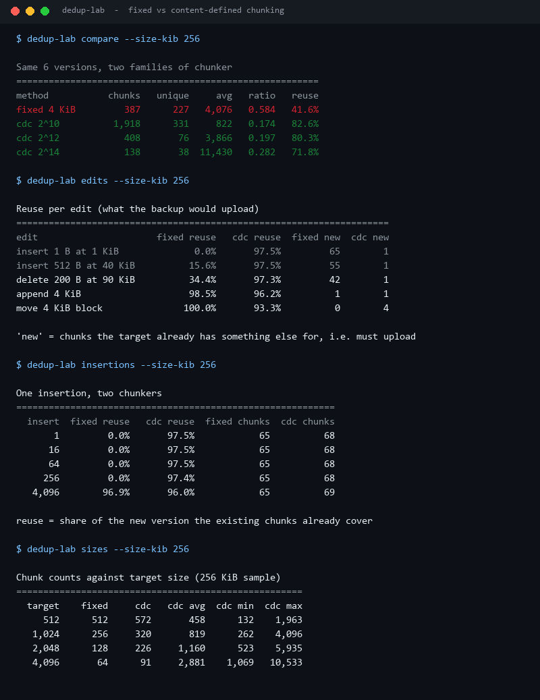
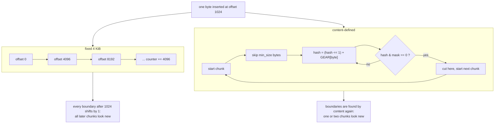
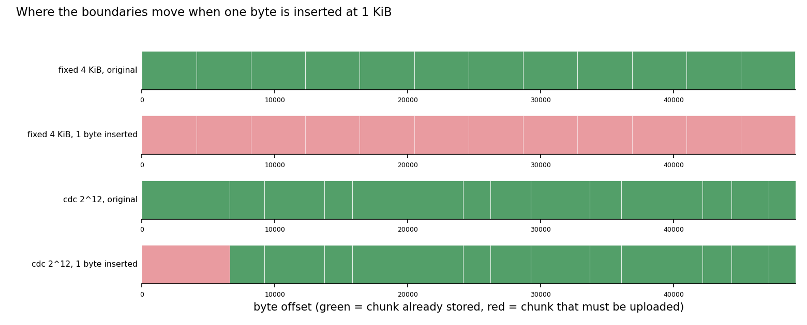
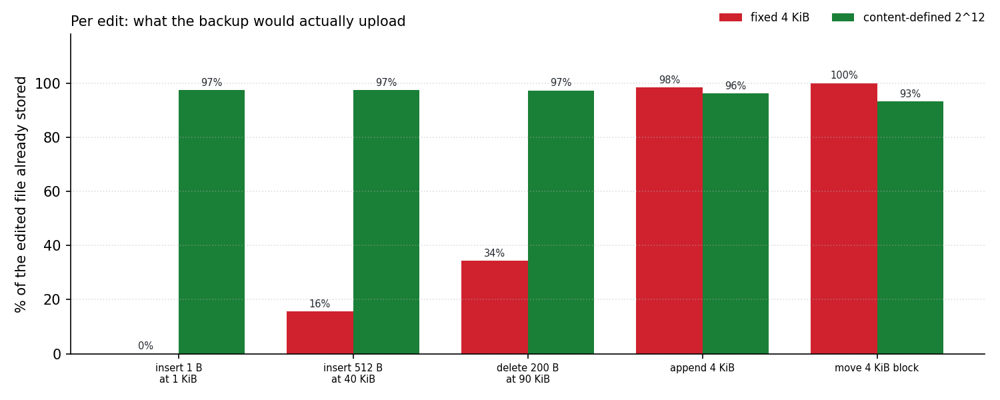
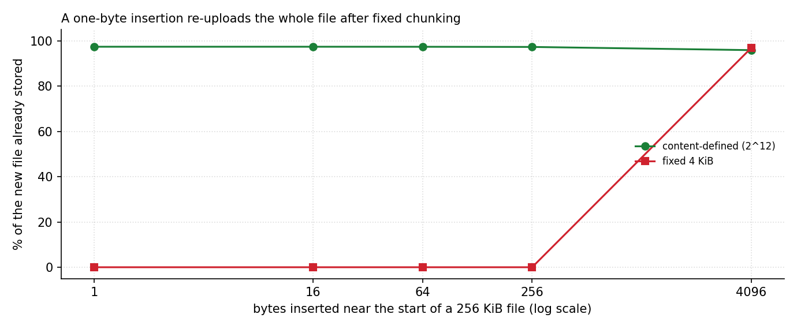

# Chunk-Dedup-Lab

**Fixed-size chunking and content-defined chunking, measured on the same edit session, so you can see exactly what one inserted byte costs each of them.**



All numbers come from `scripts/render_assets.py` running this repository's code on a deterministic
256 KiB sample.

---

## Table of contents

- [Why this exists](#why-this-exists)
- [Two ways to cut a file](#two-ways-to-cut-a-file)
- [Where the boundaries move](#where-the-boundaries-move)
- [Per-edit upload cost](#per-edit-upload-cost)
- [One insertion, five sizes](#one-insertion-five-sizes)
- [Target size and chunk-count inflation](#target-size-and-chunk-count-inflation)
- [The case where fixed chunking wins](#the-case-where-fixed-chunking-wins)
- [Install and run](#install-and-run)
- [Commands](#commands)
- [Design notes and limits](#design-notes-and-limits)
- [Tests](#tests)
- [License](#license)

---

## Why this exists

Every backup tool claims "deduplication". The interesting question is not whether it dedups a
second copy of the same file - any hash-based store does - but how much it has to upload when a
file **changes**, because that is what happens every single day.

Two chunkers are compared on identical input:

- **fixed 4 KiB** - cut every 4096 bytes, the simplest thing that can work.
- **content-defined 2^12** - cut where a rolling hash of the last bytes matches a mask, so a
  boundary is a property of the content, not of the offset.

Both are implemented here in about 60 lines each, with a deterministic data set and deterministic
hashes, so the committed numbers are reproducible byte for byte.

## Two ways to cut a file



The rolling hash is seeded at each chunk start and rolled one byte at a time, so the whole pass is
linear in the file size; because it only depends on the bytes since the previous boundary, a small
edit perturbs the chunk it lands in and then the boundaries resynchronise.

## Where the boundaries move



A 48 KiB sample, one byte inserted at 1 KiB:

- **fixed**: every chunk after the insertion now starts one byte late, so *every* chunk digest
  changes - 100% of the file is re-uploaded to store a 1-byte change;
- **CDC**: the first chunk changes (it contains the insertion), the boundary then reappears at the
  same content position, and every later chunk is byte-identical - 1 chunk out of 13 is new.

## Per-edit upload cost



| Edit | fixed 4 KiB reuse | CDC 2^12 reuse | fixed new chunks | CDC new chunks |
| --- | ---: | ---: | ---: | ---: |
| insert 1 B at 1 KiB | **0.0%** | **97.5%** | 65 | 1 |
| insert 512 B at 40 KiB | 15.6% | 97.5% | 55 | 1 |
| delete 200 B at 90 KiB | 34.4% | 97.3% | 42 | 1 |
| append 4 KiB | 98.5% | 96.2% | 1 | 1 |
| move 4 KiB block | **100.0%** | 93.3% | 0 | 4 |

The first three rows are the argument for content-defined chunking: an edit near the front of a
file costs a 4 KiB-aligned store the entire file, while CDC pays for one chunk. The append row is a
tie - alignment never mattered there - which is exactly why "we append to logs" is not evidence that
chunking strategy is irrelevant.

Across the whole 6-version session the fixed chunker stores 58% of the logical bytes and CDC stores
20%:

```
method           chunks   unique     avg   ratio   reuse
fixed 4 KiB         387      227   4,076   0.584   41.6%
cdc 2^10          1,918      331     822   0.174   82.6%
cdc 2^12            408       76   3,866   0.197   80.3%
cdc 2^14            138       38  11,430   0.282   71.8%
```

Note the metadata column: `cdc 2^10` dedups best (82.6%) but needs **1,918 chunk records** for
790 KiB of logical data - four and a half times the index entries of `cdc 2^12`. Smaller chunks buy
reuse and pay in metadata, both on the client and in the store.

## One insertion, five sizes



| Inserted bytes | fixed reuse | CDC reuse |
| ---: | ---: | ---: |
| 1 | 0.0% | 97.5% |
| 16 | 0.0% | 97.5% |
| 64 | 0.0% | 97.5% |
| 256 | 0.0% | 97.4% |
| 4,096 | 96.9% | 96.0% |

Fixed chunking is flat at zero until the insertion is a whole chunk, at which point it snaps to
96.9% - because a 4 KiB insertion at 1 KiB shifts everything by exactly one chunk and the
digests line up again. CDC is flat at ~97% throughout: the cost of an insertion is one chunk
regardless of its size, which is the property that makes it worth the extra CPU.

## Target size and chunk-count inflation

| Target | fixed chunks | CDC chunks | CDC avg | CDC min | CDC max |
| ---: | ---: | ---: | ---: | ---: | ---: |
| 512 | 512 | 572 | 458 | 132 | 1,963 |
| 1,024 | 256 | 320 | 819 | 262 | 4,096 |
| 2,048 | 128 | 226 | 1,160 | 523 | 5,935 |
| 4,096 | 64 | 91 | 2,881 | 1,069 | 10,533 |
| 16,384 | 16 | 41 | 6,394 | 4,210 | 15,216 |

Two honest observations from that table:

- **CDC produces more chunks than the target suggests** (91 chunks at a 4 KiB target, not 64),
  because the average chunk lands below the target: `min_size` is a floor and the mask decides the
  rest; the boundary distribution is not symmetric around the nominal size.
- **Chunk sizes are not uniform** - 1,069 to 10,533 bytes at the 4 KiB target. That is the price
  of content-defined boundaries, and it is why `max_size` exists: without it, a long run of
  matching hash prefixes would produce a single enormous chunk.

## The case where fixed chunking wins

Look at the `move 4 KiB block` row again: fixed reuse **100%**, CDC **93.3%**.

Moving a 4 KiB block changes nothing for a 4 KiB-aligned chunker - the chunks are the same bytes in
a different order, so all of them are already stored. CDC has to cut at the source and the
destination of the move, and those two cuts cost it 4 new chunks.

The lesson is not "CDC is better". It is that the winning strategy depends on the edit pattern:
byte-shifting edits favour content-defined boundaries, block-aligned edits favour aligned ones, and
only a measurement on your own data tells you which one you have.

## Install and run

Standard library only.

```bash
python -m pip install -e ".[dev]"
dedup-lab compare --size-kib 256
```

From a checkout without installing:

```bash
PYTHONPATH=src python -m chunk_dedup_lab compare --size-kib 256
```

## Commands

| Command | What it answers |
| --- | --- |
| `compare --size-kib N` | whole-session ratio for fixed and three CDC sizes |
| `edits --size-kib N` | upload cost of each edit, fixed vs CDC |
| `insertions --size-kib N` | reuse against the size of one insertion |
| `sizes --size-kib N` | chunk counts and size distribution against the target |
| `bench --size-kib N --fixed --bits` | one scenario, both methods side by side |
| `chunks --mode fixed\|cdc` | print the first chunks with offsets and digests |

## Design notes and limits

- **Deterministic everything.** The sample text comes from a seeded word generator, the gear table
  is a fixed 256-entry constant table, and the chunk digest is `blake2b` truncated to 12 bytes. Two
  runs on any machine produce the same boundaries and the same tables.
- **This is a gear hash, not Rabin fingerprinting.** FastCDC-style gear hashing is cheaper and
  good enough for the comparison; a real backup tool may use Rabin/Buzhash to get better
  boundary-distribution guarantees.
- **No compression, no encryption, no index.** The tool measures chunk reuse only; a real store
  also has to keep an index, and its size (visible in the `chunks` column) is part of the real
  cost.
- **`min_size`/`max_size` are set per experiment**, and they change the averages - the CLI exposes
  them rather than hiding them behind "average chunk size".
- **The data set is synthetic text.** Word-generated text has different entropy from binaries and
  from already-compressed media; on incompressible data CDC gains nothing over fixed chunking
  because every chunk is unique either way. Measure your own files.

## Tests

```bash
PYTHONPATH=src python -m pytest -q     # 36 passed
python -m ruff check .                 # All checks passed!
```

36 tests cover exact coverage of the file, last-chunk handling, digest stability, parameter
validation, resynchronisation after a one-byte insertion (and the fixed chunker's failure to do so),
delta and dedup arithmetic, dataset determinism, and every CLI command.

## License

MIT. See [LICENSE](LICENSE).

---

<sub>Screenshots and charts are generated by `scripts/render_assets.py` from this repository's own
output. No third-party data or images are used.</sub>
